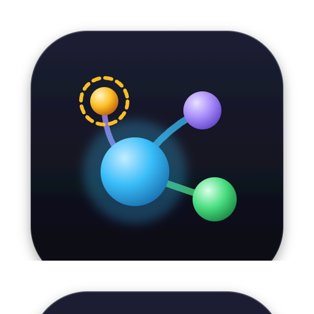
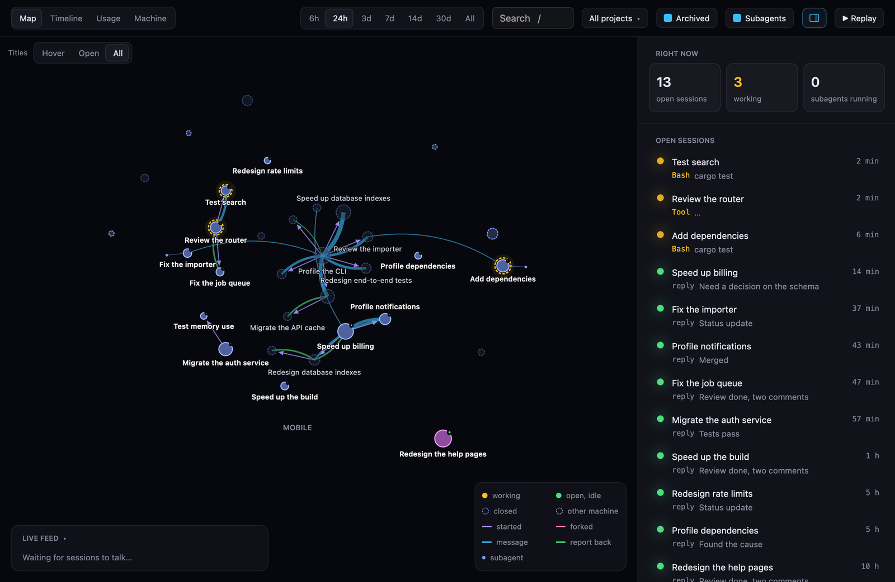
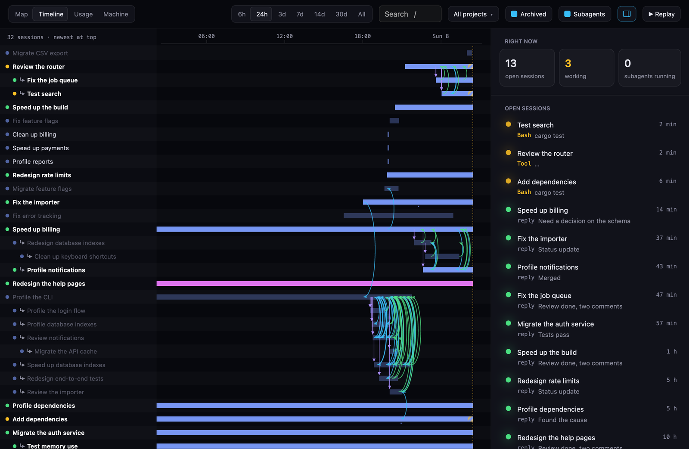

<p align="center"></p>

# Asterism

See every AI coding agent session on your machine at once: how they talk to each other, what each one is doing,
what it costs in tokens, and what it runs in RAM and CPU.

When a dozen agent sessions run at once, the machine slows down and the OS can't tell you why: Activity Monitor
shows one big "VM Helper" and twenty identical `claude` processes. Asterism puts every process and container
back under the session that started it, and draws the sessions as a map: who started whom, who messaged whom.





The screenshots come from demo mode: real sessions, with every title, project and message replaced by made-up ones.

**Status:** early. Works on macOS; Windows builds but is not tested yet.

## Install

**macOS** (13 or later), with [Homebrew](https://brew.sh):

```sh
brew trust --cask flav-code/tap/asterism
brew install --cask flav-code/tap/asterism
```

**Windows**, with [Scoop](https://scoop.sh):

```powershell
scoop bucket add flav-code https://github.com/flav-code/scoop-bucket
scoop install flav-code/asterism
```

Or download it from [Releases](https://github.com/flav-code/asterism/releases): a `.dmg` for Apple silicon or Intel
Macs, an installer for Windows. Asterism updates itself: when a newer version is out, a green arrow shows at the top
right; click it to restart on the new version. Installed with Scoop, it leaves updates to `scoop update`. To check
right away: Check for Updates… in the Asterism menu of the menu bar or the Dock icon's menu on macOS, and on Windows
in the window's own menu (its icon in the title bar, or Alt+Space) or the taskbar icon's menu.

The builds are not signed yet. On macOS, the first time you open it, macOS blocks it: go to System Settings → Privacy
& Security and click Open Anyway. On Windows, SmartScreen asks once: More info → Run anyway.

## Languages

English and French. Asterism follows the system's language; the button at the top right picks another one, and the
choice is kept. The texts live in `locales/`, one JSON file per language (`en.json` is the reference). To add one, copy
`en.json` to `<code>.json`, translate the values (keep each `%{…}` as it is), and add the code to `LANGUAGES` in
`crates/core/src/i18n.rs`; `cargo test -p asterism-core i18n` checks that no key is missing.

## Other machines

Sessions on your VMs, VPSs and dedicated servers show on the map too, next to this computer's. Add one with the
server button at the top right: a name, and what you type after `ssh` to reach it (`me@host`, or a `Host` from
`~/.ssh/config`).

- Asterism runs the system's `ssh`, so your keys, `~/.ssh/config` and SSH agent apply. It never asks for a password:
  the machine must accept your key, and its host key must be known (connect once from a terminal to accept it).
- The first time, and after each update, it copies a small agent to `~/.cache/asterism` there (`asterism-cli serve`,
  Linux x64 or arm64, from this version's release, checked against its SHA-256). The agent reads that machine's
  `~/.claude` and sends back only the result; it stops when the connection does. Nothing else changes there.
- Its sessions, open or closed, get the machine's name (in the panel, the list of open sessions and the map's tooltips), and
  its token usage counts in the Usage tab. The Machine tab still shows this computer only.
- Every session says where it runs, with an icon: a laptop for this computer, a server for another machine (added
  here, or one the Claude desktop app reaches over SSH: same session, shown once), a cloud for a session only known by
  a message from elsewhere.

## Try it

```sh
cargo run --release -p asterism            # the app
cargo run -p asterism-cli -- top           # a summary in the terminal
cargo run -p asterism-cli -- top --json    # everything, as JSON
scripts/package-macos.sh                   # Asterism.app and a .dmg in dist/
```

To save the window as a PNG without screen-recording permission (GPUI renders the frame itself):

```sh
MDB_SNAPSHOT=window.png MDB_TAB=map cargo run --release -p asterism --features snapshot
```

It shows:

- **The machine:** CPU, memory used (as Activity Monitor counts it), compressed memory, swap and its traffic,
  memory pressure.
- **Who uses it:** each agent session with everything it started (containers included), the Docker VM, each app,
  the system.
- **Each session:** its processes, its builds, its containers, and its current command (the last tool call without
  a result, linked to the process running it).
- **Docker:** containers grouped by Compose project and local cluster, flagged when they have no CPU or memory
  limit, and attached to a session when its `docker` command names them or its folder holds their mounts.

## How it finds things

- **Sessions** come from the files Claude Code keeps: the live-session registry (`~/.claude/sessions`), the desktop
  app's session files, and each transcript (a closed terminal session is only there: its first prompt titles it). These formats are internal and undocumented: they are only
  read, unknown fields are ignored and missing files are fine.
- **Processes** are matched to a session by the registry's process id, else by `--resume <id>`, else by folder and
  start time. Everything under a session's process counts for it; a process that detached from it (its parent is
  now `launchd` or `init`) is matched by its folder.
- **Memory** on macOS is the physical footprint (Activity Monitor's "Memory" column), not the resident size.
- **Docker** is read through the engine's API, on the socket of the current Docker context. A container goes to the
  one session whose `docker` command names it, else to the session whose folder most specifically holds its mounts
  or its Compose folder. When several sessions tie, it stays unattached.

## Privacy

Everything stays on the machine. The one request that leaves it: now and then, the installed app asks GitHub for
the latest Asterism release, to offer an update (`ASTERISM_NO_UPDATES=1` turns that off). Other machines you add
are reached over SSH, and only what their agent reads comes back. It never reads process environments, masks anything in a command line that looks
like a secret (tokens, keys, passwords, `Authorization` headers, credentials in URLs), shows your home folder as
`~`, and changes nothing.

## Layout

- `crates/core`: the detection, with no UI dependency. Tests run on recorded data (`tests/fixtures`).
- `crates/cli`: the `asterism-cli` command, and the agent other machines run (`serve`).
- `locales`: the app's texts, one JSON file per language.
- `crates/app`: the app (tabs Map, Timeline, Usage, Machine), built with [GPUI](https://www.gpui.rs) and [gpui-component](https://github.com/longbridge/gpui-kit).
  Sampling runs on its own thread; the window only reads the latest report.

## License

MIT, see [LICENSE](LICENSE). Asterism is not affiliated with Anthropic; it only reads the files Claude Code keeps on
your machine.

